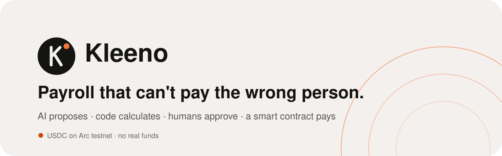
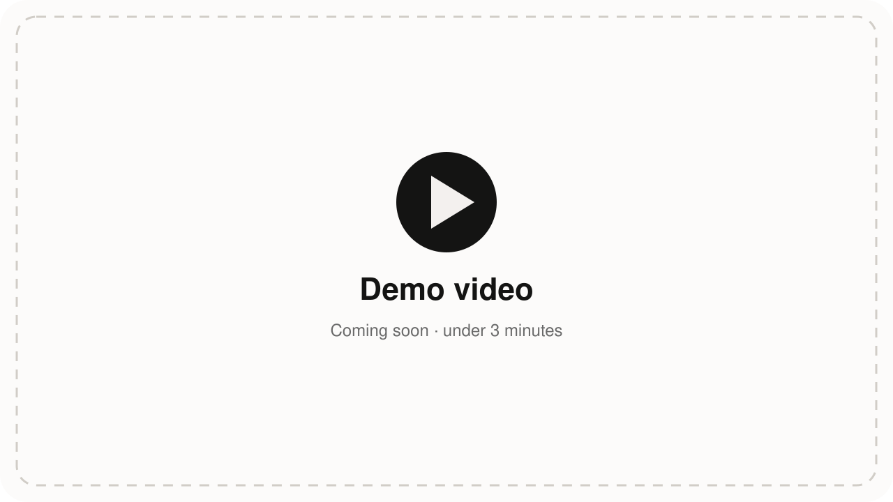
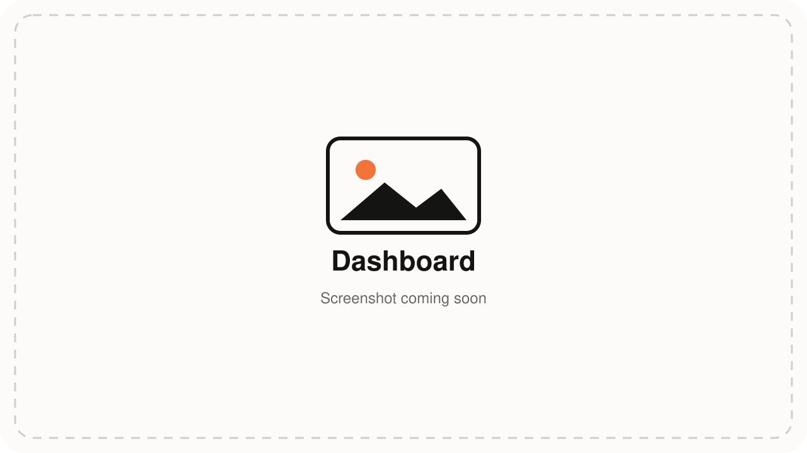
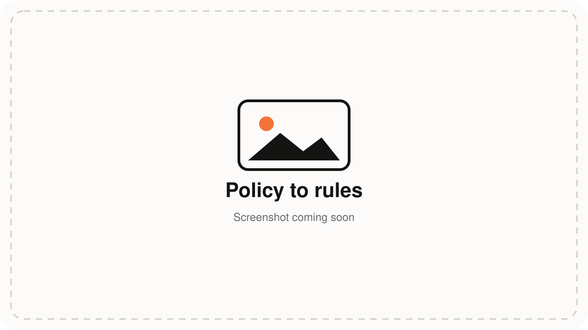
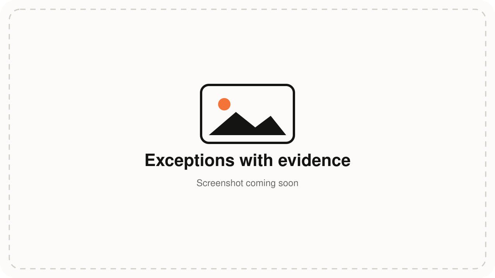
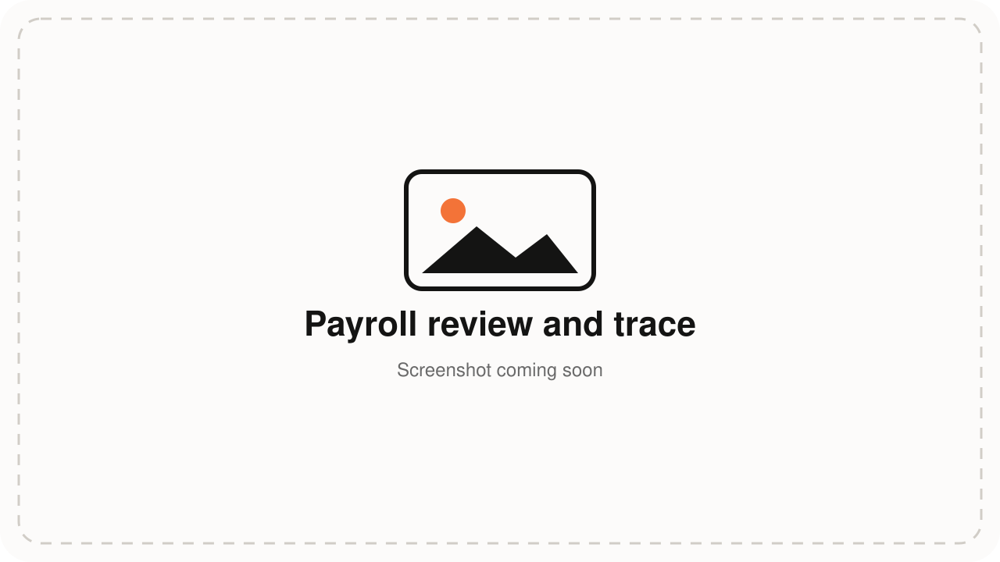
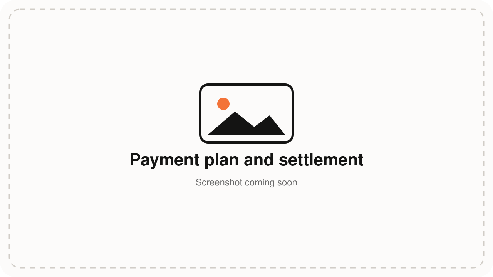

<p align="center">
  <a href="https://kleeno.orclide.com"></a>
</p>

<p align="center">
  <strong>Kleeno — Verified Payroll Automation: payroll reconciliation and guarded USDC settlement for teams that pay contractors.</strong>
</p>

<p align="center">
  <a href="https://github.com/Ivan-Ryukendo/kleeno/actions/workflows/ci.yml"></a>
  <a href="https://github.com/Ivan-Ryukendo/kleeno/stargazers"></a>
  <a href="https://github.com/Ivan-Ryukendo/kleeno/commits/main"></a>
  <a href="LICENSE"></a>
  <a href="https://kleeno.orclide.com"></a>
</p>

<p align="center">
  
  
  
  
  
  
  
  
</p>

<p align="center">
  <a href="https://kleeno.orclide.com">Website</a> ·
  <a href="#demo">Demo</a> ·
  <a href="#how-it-works">How it works</a> ·
  <a href="#safety-model">Safety model</a> ·
  <a href="#running-locally">Run locally</a> ·
  <a href="#documentation">Docs</a> ·
  <a href="docs/roadmap.md">Roadmap</a>
</p>

---

AI reads your pay policy and messy timesheets. Plain code does the maths. People approve. A smart contract pays exactly what was approved, once, in USDC on Arc testnet, and every payment is checked against the on-chain receipt.

> [!IMPORTANT]
> **Arc testnet only: no real funds move.** Kleeno is in active development for the Tameion Agents Hackathon (Canteen × Arc), 2026. Worker wallets are custodial (company-managed). Net amounts and recipient addresses are public on-chain by nature; names and payroll detail never go on-chain.

## Demo

<!-- Replace docs/media/demo-video.svg with a thumbnail and the href with the Loom/YouTube/Vimeo link. -->
<p align="center">
  <a href="#demo"></a>
</p>

| | |
|---|---|
|  |  |
| **Dashboard:** where the period stands and what's next | **Policy to rules:** AI proposes rules with cited clauses; HR approves |
|  |  |
| **Exceptions:** flagged with evidence; a human decides | **Payroll review:** every amount traced to its source rows |
|  | |
| **Payment plan and settlement:** signed plan, guarded payment, Arc receipt match | |

Screenshots use synthetic demo data only.

## Why

Small businesses pay their teams from spreadsheets. Missed or unapproved hours, duplicate timesheets, wrongly deducted leave and payments to a changed wallet are found late or never. "Autonomous" AI payroll is unsafe, because models guess numbers. Kleeno keeps the AI useful and out of the money path.

## How it works

```text
Policy (plain words) -> AI proposes rules -> validation -> HR approves the config
CSV import (names stripped in the browser) -> checks + AI classification -> exceptions -> HR resolves
-> deterministic engine with a full calculation trace -> HR approves payroll
-> payment plan (AI orders, holds and flags) -> a different person signs it
-> PayrollGuard contract pays only the signed obligations -> Arc receipt reconciliation -> audit trail
```

- **SIMULATION** (default): runs the full pipeline on last period's data and reports variances against what was actually paid. It can never pay.
- **LIVE_TESTNET**: continues to approval and guarded USDC payment on Arc testnet.
- Pay types: salaried, hourly and retainer.

## Safety model

| Principle | How it is enforced |
|---|---|
| AI proposes, never decides | AI output is schema-bound data with no amount, recipient or state fields; every suggestion is validated and needs a human |
| Code calculates | A pure, deterministic engine; the same inputs give the same result and hash; every amount has a trace |
| Four eyes | Payroll approver and payment approver must be different people, enforced in the database |
| The contract limits the agent | `PayrollGuard` commits the exact approved set per batch; the payment agent can only call `pay(obligationKey)`, once per key |
| Verified, not trusted | A payment counts as settled only when the Arc receipt matches obligation, recipient and amount |
| Fail closed | Any mismatch blocks payment and raises an exception; a kill switch stops every payment path |
| Private by default | Names never reach the server; pay and policy fields are encrypted per company; read-only public DB API; MFA for real companies |

Full security plan: [`docs/security.md`](docs/security.md).

## Tech stack

Next.js (App Router, TypeScript strict) · Tailwind + shadcn/ui · Supabase (Postgres, Auth, RLS) · Circle developer-controlled wallets · Solidity + Foundry · viem · OpenRouter · Zod · Vitest · Vercel.

## Repository layout

```text
src/core/        pure domain: money, engine, reconciliation, payments (no framework imports)
src/server/      adapters: database, auth, encryption, AI, Circle, Arc
src/app/         pages and thin API handlers
contracts/       PayrollGuard (Solidity) + Foundry tests
supabase/        migrations: schema, RLS, append-only audit, four-eyes triggers
tests/           invariants, fixtures, unit, database tests
docs/            security plan, pages, integrations, decisions, phase plans
```

## Running locally

Requires Node.js 22, a Supabase project, and (for payments) a Circle testnet account. Foundry is needed only for the contract.

```bash
npm install
cp .env.example .env      # fill in; never commit .env
npm run dev
```

Checks:

```bash
npm run lint && npm run typecheck && npm test
npm run test:db                    # needs a local Supabase stack
cd contracts && forge build && forge test
```

## Documentation

| Document | Contents |
|---|---|
| [`PRD.md`](PRD.md) | Scope, demo scenario, acceptance criteria |
| [`ARCHITECTURE.md`](ARCHITECTURE.md) | Technical design |
| [`ARCHITECTURE-ESSENTIALS.md`](ARCHITECTURE-ESSENTIALS.md) | Rules every change follows |
| [`docs/security.md`](docs/security.md) | Controls, tests and status |
| [`docs/roadmap.md`](docs/roadmap.md) | What comes after the hackathon |
| [`PROGRESS.md`](PROGRESS.md) | Where the build stands |
| [`docs/p4-p5-readiness.md`](docs/p4-p5-readiness.md) | Current P4 closeout, verification gaps and P5 next steps |
| [`docs/evidence-grounded-ai.md`](docs/evidence-grounded-ai.md) | Evidence/learning assessment, implementation specs and protected retrieval evaluation plan |

## Project status

| Phase | Status |
|---|---|
| P0 Setup · P1 Thin slice (guarded payment on Arc) · P2 Foundation (engine, auth, encryption, workers) | Done |
| Waitlist and landing page ([kleeno.orclide.com](https://kleeno.orclide.com)) | Live |
| P3 Data + AI (policy to rules, CSV import, reconciliation, table views) · P3b company system | Merged Oct 2–3 |
| P4 Payments · P4u app shell | Core merged Oct 3; planner/standing extensions implemented locally; DB/live acceptance pending; Gateway/x402 provider paths unverified |
| P4g Google sign-in | Slice 1 built locally, uncommitted; real provider round trip unverified |
| P4c Policy + pay · P4d Dashboard · P4b Payment Planner | Implemented locally; consolidated acceptance in progress; additive schema and deployed proof pending |
| Conditional P4r Evidence-Grounded AI / approved precedent | Synthetic in-memory retrieval/evidence implemented; no real searchable storage/provider integration; token hashes do not measure semantic quality |
| P5 Demo + submission | Audit, synthetic seed, browser intake and CI workflow authored; demo/traction/model drafts present; isolated CI/release/video/submission open; freeze Oct 12, deadline Oct 17 |

AI understands. Evidence grounds. Validation verifies. Humans govern. Deterministic code executes. Audit proves. Evidence-Grounded AI and Controlled Learning are planned extensions of existing validation/approval controls; learning creates proposals, not authority. Dates and conditional scope: [`PRD.md`](PRD.md#12-timeline-and-cuts). Status reflects repository history and phase notes as of Oct 5; it does not imply fresh cloud verification.

## Contact

Questions, feedback or permission requests: open an issue or contact [@Ivan-Ryukendo](https://github.com/Ivan-Ryukendo) on GitHub. Please do not report security issues in public issues; contact the maintainer directly.

## License

Copyright (c) 2026 Mirza Gamal Abdel Nasser. All rights reserved. This is proprietary, source-visible code, not open source.

- You may view and read it here. Hackathon organisers and judges may clone and run it locally only to evaluate the submission.
- You may not copy, modify, distribute, sell, host or deploy it, build on it, or use it to train AI models, without written permission.
- Testnet only: it is not meant to move real funds and is not payroll, tax, legal or financial advice.

See [`LICENSE`](LICENSE) for the full terms. Third-party components keep their own licenses. Permission requests: via [GitHub](https://github.com/Ivan-Ryukendo).
