# Kleeno — ChatGPT Project and Outreach Context

**Prepared:** October 6, 2026

**Purpose:** Upload this file to a ChatGPT project as durable context for planning customer research, outreach, scaling and future product work.
**Source of truth:** Kleeno repository documents named below. This summary is portable context, not a replacement for approved phase specifications or security rules.

## How to use this context

Use it to understand Kleeno, draft research plans, organize prospect information, prepare interview questions and create outreach drafts for human review. Keep facts, proposals and unknowns distinct. Do not claim a feature is shipped because it appears in the future roadmap. Do not send messages, publish content, spend money, connect accounts or change production systems based only on this file.

When repository documents conflict, follow current user direction and the active rules in `ARCHITECTURE-ESSENTIALS.md`; ask about unresolved conflicts. For current implementation and verification status, check `PROGRESS.md` and `docs/p4-p5-readiness.md`. The canonical future sequence and go-to-market plan is `docs/roadmap.md`.

## What Kleeno is

Kleeno is **Verified Payroll Automation**. It helps HR/payroll teams turn approved policy and payroll evidence into explainable calculations, resolve exceptions, review payroll and—only in guarded testnet mode—settle committed obligations. The near-term commercial direction is a payroll review workspace that complements a customer's existing payroll/tax provider. A full production US payroll service is a separate future programme.

**Product rule:** AI understands; evidence grounds; validation verifies; humans govern; deterministic code executes; audit proves.

### Customer direction

- Small and growing businesses that review spreadsheet-based payroll.
- Payroll bureaus/accounting firms that serve multiple client companies through explicit, tenant-isolated memberships.
- Larger businesses for discovery/design partnerships; enterprise capabilities and commitments require separate validation.
- Initial acquisition recommendation: start pilots with smaller companies and bureaus managing a few clients, while interviewing larger businesses. This is a sequencing recommendation, not a market-size restriction or validated research finding.

## Current system architecture

```mermaid
flowchart LR
  UI[Next.js App Router] --> API[Thin route handlers]
  API --> S[Server adapters: auth, DB, AI, Circle, Arc]
  S --> DB[(Supabase Postgres: RLS, constraints, audit)]
  S --> CORE[Pure deterministic domain core]
  CORE --> VAL[Validation and evidence checks]
  VAL --> SNAP[Immutable calculation snapshot and hash]
  SNAP --> HUMAN[Human payroll approval]
  HUMAN --> OBL[Committed obligations]
  OBL --> GATE[Single payment safety gate]
  GATE --> AGENT[Payment agent and Circle wallet]
  AGENT --> GUARD[PayrollGuard on Arc testnet]
  GUARD --> SETTLE[Independent settlement reconciliation]
  SETTLE --> AUDIT[Append-only audit]
  AI[AI provider] --> CORE
  EXT[External systems / future connectors] --> S
```

- **Application:** Next.js App Router, strict TypeScript, Tailwind/shadcn UI; deployed through Vercel.
- **Domain:** `src/core` contains deterministic, vendor-independent business logic; `src/server` contains trusted adapters and repositories; `src/app` contains pages and thin API handlers.
- **Data and identity:** Supabase Auth and Postgres with row-level security, tenant-scoped constraints, server-side repositories, immutable approved records and append-only audit. Postgres remains authoritative; no second payroll database is planned.
- **AI:** OpenRouter adapter with validated inputs/outputs. AI may explain or propose; it cannot calculate authoritative pay, approve, alter policy, choose recipients or authorize payment. Future retrieval uses evidence-scoped candidates and Supabase pgvector only after privacy/storage decisions; it is not yet production retrieval.
- **Payments:** Circle developer-controlled wallets and `PayrollGuard` Solidity contract on Arc testnet. Payment submission is gated; settlement must be independently reconciled. SIMULATION is the default and cannot pay. Arc mainnet/production payroll is not enabled.
- **External data:** HR/payroll/accounting providers are evidence sources/destinations, never authorities. Imported evidence follows normalization, provenance, validation, reconciliation and snapshot controls. No Apollo-to-Kleeno application connector is documented or approved.
- **UI:** `DESIGN.md` and `docs/pages.md` own Kleeno's visual and interaction rules. Current interfaces and future UI concepts must remain distinguishable.

### Payroll flow and trust boundaries

Approved policy configuration → anonymized import → validation/reconciliation → human resolution of exceptions → deterministic calculation and hash → separate payroll approval → committed obligations → separate payment authorization → payment gate → testnet settlement → independent receipt matching → append-only audit.

AI retrieval and learning may supply evidence or propose changes, but never bypass validation, human approval, immutable records or financial controls. External approvals are evidence only, not Kleeno approvals. Never put secrets, payroll data or sensitive employee data in prompts, analytics or outreach tools.

## Current status snapshot (October 6, 2026)

This is a repository-reported snapshot; it is not a fresh independent verification of cloud or provider behavior.

- The project is in the hackathon closeout period, with an organizer deadline of **October 17, 2026**; exact cutoff time/timezone remains unconfirmed.
- Core P4/P4u are recorded as merged. Remaining approved P4 work is local and uncommitted; preserve it. Read `PROGRESS.md` before treating any current branch item as new work.
- P4 features and P5 preparation have substantial local implementation. Reported checks: 463 unit/invariant tests across 57 files, lint, typecheck, production build and a synthetic table browser harness passed. These do not establish isolated database, deployed browser, live provider, cloud or end-to-end payment acceptance.
- Database migrations `20261005000001`–`20261005000004` are unapplied; database acceptance suite is authored but unexecuted. The remote development `.env` is not a safe isolated test target.
- Google/MFA, Circle provisioning/funding and webhook behavior, current full settlement, Gateway/x402, cloud/deployed browser, remote CI and Kimi extension review remain unverified per project status.
- The public SaaS roadmap is approved as future direction and documented, not implemented. No customer interviews, traction, conversion rates, paid launch, subscription provider activation, production payroll or Apollo connector are established by this document.

## Delivery and scaling plan

The approved future roadmap is ordered and gated; it is not authorization to implement every item at once.

1. Verify existing code, migrations, database tests, authentication, deployed browser and provider flows in safe isolated environments; record evidence and owners.
2. Interview target HR/payroll teams and define one pilot use case, baseline, measures and consent.
3. Specify and review accessible journeys before UI changes.
4. Extend existing tables/workflows; keep computed amounts traceable and read-only, show source/formula, and keep graph/table/activity views on the same records.
5. Add versioned per-rule policy priority only with compatibility, conflict handling, preview and approval.
6. Define a separate commercial review/sign-off and correction lifecycle; it must not create payment authority or rewrite approved history.
7. Expand platform operations/support using narrow roles, accurate account metrics and audited safe actions.
8. Add company-opt-in encrypted basic employee identity and self-only views only after access, deletion and privacy controls pass.
9. Add subscription/demo lifecycle after the billable event, timezone, costs and data lifecycle are specified. Stripe test mode first; billing never authorizes payroll payments.
10. Add scoped read-only API/MCP and evidence retrieval after revocation, tenant/version/privacy and provider terms are reviewed.
11. Prove monitoring, alerts, incident ownership, backups, restore/recovery and commercial operations before paid launch. Managed Grafana Cloud is a candidate, not a commitment.
12. Specify production US payroll separately, including providers, jurisdictions, tax/legal duties, funding, returns, security and reconciliation.

### Scaling principles

- Retain Supabase/Postgres as the authoritative store and existing tenant relationships; no graph database or Turso requirement is established.
- Extend current domain services and repositories; avoid duplicate engines, audit logs or admin backends.
- Measure representative load, latency, reliability, AI/provider cost, support load and recovery before setting capacity promises or service objectives.
- Keep tenant isolation, idempotency, immutable snapshots, append-only audit and independently reconciled outcomes through every scale step.
- Separate demo/test records and metrics from real customers; distinguish users, companies, memberships, workers, leads, trials and paid organizations.
- Bigger-company and bureau support requires tested delegated access, safe client switching, explicit billing ownership, procurement/security review and capacity evidence.

## Customer discovery and outreach plan

The roadmap proposes a **first milestone of 100 activated HR/payroll reviewer accounts**—a target, not a forecast. Count activated accounts separately from companies, paid organizations, workers, leads, visits and demos. Proposed activation means an authorized reviewer completes a supported import and inspects a traceable calculation in a non-test workspace. Use real pilot evidence before publishing claims.

Suggested sequence:

1. Prepare accurate product, security/privacy, demo and booking material; verify business email delivery/authentication and source attribution.
2. Manually research a small initial list (roadmap proposal: 30 organizations across small businesses and bureaus). Store only necessary business-contact data and prospect-fit evidence.
3. Conduct willing discovery conversations; ask about workflow, exceptions, frequency, current tools, time spent and desired outcome. Do not request salary files for interviews.
4. Recruit roughly 3–5 consenting design partners as an experiment, run alongside their existing provider, and measure an agreed baseline. This is a planning hypothesis, not a commitment or existing result.
5. Improve onboarding and only broaden channels after fit, activation, support effort and willingness to pay are evidenced.
6. Start with founder-led conversations, professional relationships, accountants/payroll partners and relevant communities. Consider directories or paid tests only with current rules checked, measured tracking and an owner-approved budget.

A proposed workload of 10–15 researched prospects per week and an acquisition budget range of $0–$200/month are planning suggestions only. **No outreach, publication, paid campaign or spend is authorized by this file.** The roadmap suggests an initial note plus no more than two useful follow-ups over two weeks, then stop unless invited to continue. Respect applicable outreach rules, platform terms, opt-outs and suppression requests; use a real sender and truthful personalization.

### Apollo and ChatGPT workflow recommendation

Apollo is **not currently part of Kleeno's architecture**. Treat it as a separately operated prospect research/CRM service unless a future phase explicitly approves a product integration.

- First check whether an official Apollo connector is available for the user's ChatGPT account and what scopes/data handling it actually supports. Availability and account configuration are not verified here.
- If available, grant only needed read scopes and review connected-app permissions, retention and account policies. Otherwise, use a small, manually reviewed export of relevant business prospect fields rather than building an integration.
- Keep ChatGPT's role to summarizing public business context, organizing fit signals, drafting interview questions and preparing message drafts. Verify every factual claim against a reliable source.
- Human review must approve the recipient, personalization, claims and final send. Keep opt-out/suppression status authoritative in the outreach system and check it before every send.
- Do not upload payroll files, employee records, private policy documents, credentials, secrets, sensitive support conversations or unnecessary personal data into Apollo/ChatGPT. Use synthetic or public business context for drafting.
- Do not automate bulk collection or sending. A draft is not consent or authorization to contact.

**Example positioning (draft; verify before use):** “Kleeno helps HR and payroll teams review spreadsheet payroll, understand policy exceptions, and trace calculated amounts before using their existing payroll provider.” Do not claim tax filing, production wage payments, guaranteed savings, customer results or features that have not passed their release gate.

**Example discovery opener (draft; not sent):** “We’re building Kleeno to help payroll teams review spreadsheet workflows and explain policy exceptions. Which part of payroll review takes the most time for your team?” Personalize only with genuine, verified context and stop if the person declines.

## Important decisions still open

Resolve these in their relevant phase specification before implementation or public promises: first pilot segment and measured targets; accepted review lifecycle; employee-data retention/deletion; subscription usage event and billing timezone; final pricing and demo expiry/export terms; first supported connector; real embedding provider and searchable-data storage/privacy; operational availability/recovery objectives; enterprise commitments; production payroll provider/jurisdiction/tax responsibilities. Apollo connector availability and any direct Kleeno integration are also unverified and unapproved.

## Repository references

- `AGENT.md`, `docs/memory/project.md`, `PROGRESS.md` — context protocol, durable decisions and current resume state.
- `ARCHITECTURE-ESSENTIALS.md` — active security, AI, data and payment rules.
- `ARCHITECTURE.md` sections 27–28 — future architecture and tooling recommendations.
- `PRD.md` sections 14–15 — future product, public launch and customer outcomes.
- `docs/roadmap.md` — canonical twelve-step sequence, public-launch checklist and acquisition programme.
- `docs/p4-p5-readiness.md`, `docs/p4-database-acceptance.md` — current evidence gaps and safe verification gates.
- `DESIGN.md`, `docs/pages.md` — established visual and page direction.
