# Kleeno System Completion Implementation Plan

> Execution: explicitly requested `subagent-driven-development`, in this session. Supply agents complete task/context; spec review precedes quality review. The user's parallel-build request overrides the skill's serial-implementer default, with isolated worktrees and exclusive ownership.

**Goal:** Complete the retained policy-to-settlement system, document uploads, dashboard/audit experience and genuine payment verification while preserving existing work.

**Architecture:** Browser parsers produce reviewed text or anonymised import evidence. Existing tenant-scoped repositories encrypt policy clauses; deterministic calculation, separate human approvals, the single payment gate, PayrollGuard and independent settlement remain authoritative. Reuse existing Gateway/x402 implementations.

**Tech Stack:** Existing Next.js/React/TypeScript, shadcn/ui, Supabase, Zod, Vitest, Foundry, Circle and Arc testnet. Add maintained format parsers/browser-test tooling only where installed dependencies cannot cover the required behavior; check current APIs/advisories first.

**Status:** Owner-approved mission (2026-10-05); implementation and reviews are in progress. This approval does not establish cloud migration, deployed database, browser/live-provider/payment proof or deployment authority.

## Confirmed choices and open external gates

- User confirmed: parse normal uploads, then encrypt extracted text for storage. First policy formats: MD/TXT/DOCX/text-PDF; scanned PDFs report OCR required. No image-AI/OCR pipeline or encrypted-document password support in this upload slice.
- Original files stay local. Store canonical compact text/numbered clauses, document IDs/content hashes and clause origins through encrypted repositories; no plaintext Markdown mirror, file buckets or forced PDF conversion.
- User confirmed actual calendar-day proration: inclusive employment/period intersection divided by actual period days for SALARIED/RETAINER only. Preserve half-up component rounding; hourly uses actual approved hours. Unpaid leave cannot deduct days already excluded by employment proration.
- S69's 100-page PDF limit is enforceable. DOCX raw-text extraction cannot reliably count rendered pages; approved amendment replaces that DOCX page limit with the existing extracted-text/clause bounds plus 20 MB maximum inflated archive data and 1,000 ZIP entries per document. Approved multi-file limit: 10 files, 20 MB combined originals, still <=10 MB each.
- Keep existing 40,000 total text characters and 2,000 per clause; align all shared schemas with S69's 500-clause ceiling (currently 200). A clause set may span documents but still observes the total bound.
- Success green remains proposed in DESIGN.md; use existing neutral/risk tokens until explicit approval.
- P4b planner and standing authorization are selected and in progress; payment execution remains behind its existing approvals, guards and external readiness checks. P4r is selected synthetic-first and in progress; real-policy storage/provider use remains gated. Human-signed deterministic fallback is already available and never qualifies for standing authorization.
- Real testnet tests require configured/funded wallets, provisioned guard, designated non-demo company and two distinct authorized approvers. Passwords/keys/tokens stay out of chat.
- Kimi installed project-locally at `.tools/kimi-webbridge/bin/kimi-webbridge.exe` using an inspected installer copy that changes only installation and temporary-download paths; `-NoStart -NoSkill` preserves the existing skill and defers daemon startup. The stock installer hardcodes `%USERPROFILE%/.kimi-webbridge` and was not run unchanged. Binary help/status and ignored-path checks pass; status is `running:false`. Browser extension installation/connectivity and daemon/extension/skill version compatibility must be checked before post-build Kimi review. The daemon's default runtime state uses the profile path; only the executable/installer/download were installed in the project, and no running bridge/connected extension is claimed.

## Workflow and element placement

```mermaid
flowchart LR
  A[Local policy upload and text preview] --> B[Encrypted clauses and validated AI proposal]
  B --> C[HR-approved configuration]
  C --> D[Anonymised import]
  D --> E[Reconciliation and human resolutions]
  E --> F[Deterministic calculation and trace]
  F --> G{Mode}
  G -->|SIMULATION| H[Validated results and variance; cannot pay]
  G -->|LIVE_TESTNET| I[Hash-bound payroll approval]
  I --> J[Immutable obligations]
  J --> K[Separate approver signs exact plan]
  K --> L[PayrollGuard commitment and single gate]
  L --> M[Circle payment agent]
  M --> N[Independent Arc receipt match]
  N --> O[Settlement, receipts and audit]
```

| Screen | Placement |
|---|---|
| Configuration | Upload/Browse above existing text entry; drop area, formats/limits, status and editable extraction preview before AI proposal; provenance alongside citations and scope/coverage/conflicts alongside rule review |
| Import/workers | XLSX enters existing mapping/anonymisation; local name-key unlock on workforce/import screens; authorized row history panel |
| Dashboard | Period selector/mode/live status, then stepper, real counts/role-specific to-dos, activity and run history |
| Settlement | Preserve plan/holds/signing/kill switch/top-up/receipt controls; Gateway funds own company wallet and x402 supplies read-only verification |
| Audit | Read-only linked event timeline, authorized filters and safe entity references; no raw prompts, names or chain-of-thought |

Post-build expert uses actual screenshots to identify issues and precise placement, then validates before/after changes. DESIGN/pages remain authoritative; UI inspection does not prove backend security.

## Policy-driven resource columns (owner request, 2026-10-05)

The owner requested resuming the whole P4 build with multiple subagents, Ponytail for the backend, the existing design system and appropriate Motion interactions. The three-worker mission and resource-column contract are owner-approved; implementation is underway.

### Baseline observed before this build

`src/core/views/index.ts`, `src/server/db/table-views.ts` and `src/components/table-view.tsx` implement fixed allow-listed columns, selection, search, filters, sort, exact money totals and authorized CSV export. Column order exists in the view schema, but the UI does not provide drag reordering. View state is local component state; persistent named layouts, policy-generated columns, formula disclosure and cell comment threads are not implemented. CSV export currently follows catalog order instead of the selected view order; verify and correct this in the column acceptance work.

Leave and performance are in approved P4 scope. Leave entitlements are company-configured with no preset; HR must provide policy and evidence. Performance supports actual/target percentage and weighted KPIs with evidenced values and weights totaling 100. Missing or invalid evidence stays Data required; policy prose alone never establishes employee facts.

### Required behavior

- HR creates typed custom columns; policy interpretation may propose definitions and workflows for HR review. Store definitions as validated data, not SQL, JavaScript, arbitrary executable expressions or AI-calculated payroll amounts. Each definition identifies its source, rule/config version, unit/type, permitted workflow and validation constraints.
- Evaluate supported formulas deterministically against authorized, period-bound evidence. Missing, conflicting or unsupported inputs display **Data required** or a review state, never a plausible numeric default. Approved configuration and immutable run snapshots remain authoritative; presentation and comments never change approvals or payments.
- Each applicable cell exposes source evidence, rule/formula and validation outcome. Payroll changes continue through existing guarded workflows, with hash/approval invalidation where required. Computed outputs are read-only. Approved typed source inputs may be edited only through reviewed, reasoned and audited forms.
- Drag columns left/right; provide visible Move left/Move right controls for single-pointer and keyboard operation. Preserve selected order in query results, saved layout and CSV export, with tenant/role validation on restore. Personal persisted layouts are approved.
- Formula disclosure is available on hover, focus and click/tap. Use DESIGN tokens, plain text and 150–250 ms functional transitions. CSS first; `motion/react` only where CSS is insufficient. Honor reduced motion; do not animate money or approval decisions or shift controls under the pointer.
- Right-click opens a Kleeno-styled context menu in the agreed comment area. A visible Comments action provides keyboard/touch access. Shared cell-level threads for authorized company members are approved. Bind threads to stable authorized entity/column IDs, not displayed row indexes; encrypt sensitive text, derive authors/company from the session, bound input and maintain audit history. Comments cannot approve payroll, resolve an exception or become trusted AI precedent.

### Owner-confirmed decisions

1. **Resources:** implement company-configured leave (no default entitlement) and both actual/target and weighted KPI performance; missing evidence remains Data required.
2. **Cell changes:** computed results are read-only; typed source inputs are editable only through reviewed, reasoned, audited forms.
3. **Layout/comments:** personal persisted layouts and shared authorized cell threads.
4. **Mission/P4r:** three-worker mission and upload bounds are approved; P4r is selected synthetic-first. Real searchable-policy storage remains subject to privacy and provider review.

### Acceptance before closure

Write failing behavior checks before implementation: typed/unsupported definitions; missing-source refusal; deterministic rule/formula evaluation; source/config/version binding; edit permissions and approved-record immutability; cross-company/role denial; stable comment targeting after filtering/sorting; escaped plain-text comments; order persistence/export; concurrent layout/comment updates; keyboard/touch alternatives and reduced motion. Run the relevant core, API, DB and browser checks. Show the actual implemented workflow to the owner. Report external setup or unsupported resource models explicitly; no synthetic evidence presented as a real employee result.

## Mission brief — owner approved 2026-10-05

**Goal:** complete retained P4 policy-to-settlement behavior and the clarified resource-column presentation, with verified controls and honest external-status reporting.

**Total agents:** three child workers plus the parent; later rounds reuse slots for payment verification, P4b/P4r and independent spec/quality reviews. **Model strategy:** inherit the available Codex model; the skill's Gemini/Claude choices are unavailable in this runtime. **Expected cost:** high; no invented quota percentages.

| Agent | Exclusive scope | Input/output | Dependencies |
|---|---|---|---|
| A — uploads/imports | `src/core/ingest/documents.ts`, focused XLSX helper, `policy-upload.tsx`, local-name component, `import-wizard.tsx`, ingest tests | Approved format/bounds and provenance contract → tested local extraction/import components | Approved upload limits; B/parent integrate host components |
| B — policy/pay and column backend | Existing config/engine/AI schemas and scoped repositories; worker/config forms; `src/core/views/index.ts`, `src/server/db/table-views.ts`; assigned additive migrations and focused tests | Approved scopes/proration/resource contract → deterministic scoped policy/pay and column/comment contracts | Approved resource/edit contract; A component handoff; parent owns shared API/package integration |
| C — workspace experience | Dashboard, standalone history/audit components/read models, `src/components/table-view.tsx`, focused UI/read-model tests | DESIGN/pages and approved column contract → real dashboard/history and accessible table/comment/formula interactions | Approved layout/comment contract; B's versioned contract before wiring dynamic data |
| Parent — integration/review | Shared APIs, worker-page host, package/lock, CI, docs/status | Reviewed slices → integrated checks, payment-verification handoff and independently reviewed completion | No concurrent writes to child-owned hosts; no phase marked complete from local-only evidence |

Each worker receives scoped project/role context and follows Ponytail full on backend paths only. UI uses UI/UX Pro Max and shadcn under DESIGN. All existing uncommitted work is preserved. Owner approved this mission and DOCX bounds; three workers started. Parent temporarily owns core/views and table-views while B completes config/pay, avoiding concurrent edits. No cloud migration, deployment, public release or payment authorization is inferred from this brief.

### Confirmed answers (2026-10-05, supersede pending defaults above)

- Include leave-balance and performance systems in P4. Leave policies are company-configured, with no preset entitlement; HR confirms dates, annual/monthly entitlement, credit timing, units, opening evidence and carry-over cap/expiry. Missing policy or evidence stays Data required.
- Support both single actual/target percentage and weighted multiple-KPI performance. Require defined metric IDs, target/actual source evidence and weights totaling 100; missing/zero targets do not produce a score. These informational resources do not change pay; a future payroll dependency requires a separately approved deterministic rule, snapshot/hash and review contract.
- Support read-only computed results and editable typed source inputs through reviewed, reasoned, audited forms. Never directly edit calculated pay or an approved snapshot.
- Personal persisted layouts; shared cell-level threads for authorized company members. Styled right-click menu plus visible keyboard/touch Comments action. Comments grant no authority.
- Mission and DOCX limits approved. Build P4r against synthetic evidence first; real searchable-policy storage/provider review remains an explicit gate. No successful external/provider/payment verification is implied.

## Parallel ownership and review gates

Three child slots plus parent. Parent provides AGENT/project/role context; durable implementation handoffs go in `docs/memory/`. Preserve existing uncommitted OAuth/docs work; isolated snapshots include required dependencies without silently committing them.

| Lane | Exclusive files/work | Dependencies |
|---|---|---|
| A: uploads/imports | Standalone `policy-upload.tsx` and local name-unlock component, document/XLSX ingest helpers, `import-wizard.tsx` and ingest tests | Agreed clause/provenance contract; no edits to config/worker/history integration hosts |
| B: policy/pay | Config scopes/catalog, worker metadata, additions/proration, AI cache, config/worker/calculation repos, migrations/tests; exclusively `config-forms.tsx` and `worker-forms.tsx` | Approved proration; B embeds A's reviewed upload component into configuration host after component handoff |
| C: experience | Dashboard/audit pages/components, standalone worker-history panel/read models and safe seed/e2e preparation | No worker-form/page or local-unlock edits; integrate B schema before DB acceptance |
| Parent | Workers page integrates B metadata forms, A local-name component and C history panel after their reviews; shared API integration, package/lock, CI, docs/status | Only integrate reviewed slices; never stage unrelated work |

When a lane passes reviews, use its free slot for payment/S33/integration or final expert review. One owner at a time for settlement/payment code, shared schemas, migrations and package files. Every task: behavioral test -> observed intended failure -> minimal implementation -> targeted pass -> refactor -> fresh spec reviewer -> fresh quality reviewer. Findings go back to implementer and require re-review. Phase commits follow repository checks/staged secret scan/branch/PR process, not independent commits of shared working-tree files.

## Task 0 — Build baseline and P4g closure

**Files:** `eslint.config.mjs`, `docs/phases/P4g.md`, existing OAuth tests; preserve current auth implementation.

1. Record current unit/typecheck pass and lint failure: git-ignored `.agents/skills/**/*.cjs` are currently linted and raise CommonJS errors. Add only a tooling-directory exclusion; verify application lint still applies.
2. Run `npm run lint`, `npm run typecheck`, `npm test`, `npm run build`; record actual results. Complete real Google/MFA checks with available provider setup instead of rebuilding callback handoff or treating source as S74 proof.
3. Contracts/tests may be prepared in parallel; unmet provider/DB/CI gates stay explicit and block false phase-closure claims.

## Task 1 — Drag/drop and policy extraction (S69)

**Files:** A creates `src/core/ingest/documents.ts`, `src/components/policy-upload.tsx`, `tests/unit/ingest/documents.test.ts`. B exclusively modifies `src/components/config-forms.tsx`, `src/core/config/index.ts`, `src/core/ai/inputs/policy.ts`, `src/server/ai/policy.ts`, `src/server/db/configs.ts` and `tests/db/ai-config.test.ts`; parent owns `src/app/api/configs/route.ts` integration. A delivers extracted-text/provenance component callbacks to B, then B embeds the reviewed component; API/encryption acceptance follows integration. This is a contract handoff, not concurrent edits to the same hosts.

1. Write cases for MD/TXT/DOCX/text-PDF, scanned/mixed pages, malformed/unsupported/protected files, extraction/size/clause limits, cancellation/stale results, injected text, tenant isolation and encrypted provenance. Run `npm test -- tests/unit/ingest/documents.test.ts`; see intended missing-behavior failure before implementation.
2. Native File APIs handle MD/TXT. Candidate browser adapters: reviewed pdfjs-dist text extraction and mammoth raw-text extraction; dynamic-load only when needed. Do not render HTML, execute macros/scripts, follow links or process embedded attachments. Bound DOCX archive inflation/entries and parser output; reject unsafe archives.
3. Normalize predictably into plain Markdown-compatible paragraphs, preserving available page/paragraph anchors. PDF order/tables may be imperfect: editable preview and HR review are mandatory. Flag scanned/partially scanned content and block silent partial-policy submission until reviewed text is supplied.
4. Browse files and drag/drop share one validation path; visible formats/limits, status/errors, remove/replace/cancel, keyboard and single-pointer alternatives. Keep text entry and the existing AI-proposal/HR-approval flow.
5. Per-file max 10 MB; combined originals max 20 MB/10 files; PDF max 100 pages; DOCX inflated archive max 20 MB/1,000 entries. Server rechecks 40,000 total characters, 2,000 per clause and 500 clauses. Proposed DOCX/aggregate bounds require owner approval above, with tests for honest and falsified archive metadata and actual inflation limits. Server recomputes hashes; filenames/originals never enter logs or plaintext storage. No object storage for files not retained.
6. Run extraction/injection checks plus `npm run test:db -- tests/db/ai-config.test.ts` on the designated test DB. Review actual browser payload and encryption-at-rest evidence, then spec and quality review.

## Task 2 — Scopes, worker evidence and cache (S71–S72)

**Files:** config/engine/AI schemas, `src/server/ai/policy.ts`, `src/server/db/configs.ts`, `workers.ts`, `ai.ts`, configuration/worker UI, additive migrations; create `tests/invariants/config/scope.test.ts`, `tests/unit/ai/cache.test.ts`, `tests/db/ai-cache.test.ts`; extend worker/config DB tests.

1. First failing cases: personal > group > multi-group > company, code-derived categories, equal-level conflict blocks approval, explicit override confirmation, duplicates/uncovered workers, winning-and-overridden-rule trace and cache tenant/version misses.
2. Add documented department/job title/worker type/tags/employment dates. Preserve tenant session derivation/composite FKs, compensation encryption and approved-record immutability. Scope proposals cite existing document/clauses; bump strict schema/prompt versions with contract changes.
3. Cache by company + clause-set hash + provider/model + prompt + schema versions; revalidate reused output, preserve immutable AIExecution/audit linkage and HR approval. Duplicate/near-duplicate comparison runs through tenant-scoped DB candidate queries, using content hashes then bounded server-decrypted text comparison; never add a plaintext policy index. Text similarity adds warnings only; deterministic rule/scope matching decides conflicts. Test cross-company candidates, exact/near matches and non-matches. Calculation traces retain both winning and overridden rule references.
4. Run targeted scope/AI/worker checks and DB isolation/immutability tests; both reviews precede shared-schema integration.

## Task 3 — Additions, fixed deductions and proration (S73)

**Files:** `src/core/config/index.ts`, `src/core/engine/index.ts`, snapshot/hash inputs, `src/server/db/calculate.ts`, guarded run-input APIs/UI and additive migrations; create `tests/invariants/engine/additions.test.ts`, extend `tests/unit/core/money-engine.test.ts`, `tests/db/calculate.test.ts`, `tests/db/snapshot.test.ts`.

1. First failing expected-money cases: bonuses/commissions/reimbursements, fixed deductions, full/zero/one-day employment, month boundaries/join/leave, unpaid-leave interaction, exact trace sums and input-sensitive hashes.
2. HR enters worker/run-bound amounts and reasons under S35 caps; AI never supplies amounts. Encrypt immutable snapshot inputs; changes require fresh calculation/hash/approval.
3. Implement only the selected deterministic proration method. Round component lines half-up to cents, sum exact micro-USDC and preserve net=gross-deductions/ceilings. Trace component/source/rule-version/inputs/step; ambiguous dates/unsafe net fail closed.
4. Run additions/engine/hash and DB snapshot/approval tests, then both reviews. Preserve protected fixtures and W003's existing paid-leave scenario.

## Task 4 — XLSX and local names (S70/S42)

**Files:** A owns focused XLSX ingest helper, `src/components/import-wizard.tsx`, standalone local-name-unlock component and existing `src/core/ingest/name-key.ts`; creates `tests/unit/ingest/xlsx.test.ts` and extends name-key/ingestion checks. Parent alone integrates local reveal into `src/app/(app)/(workspace)/workers/page.tsx` after B's metadata forms and C's standalone history panel are reviewed. A does not edit the worker/history hosts.

1. First failing cases: values-only/formula-macro non-execution, bounded archives, row/column/currency limits, stripped names and wrong-password refusal. Choose the minimal maintained browser parser after API/advisory review.
2. Selected sheet enters existing CSV mapping/anonymisation/normalization. Retain S25 limits (5 MB, 10,000 rows, 50 columns, 1,000 characters/cell). Never evaluate formulas; any cached result follows ordinary evidence validation.
3. Unlock passphrase-encrypted name key locally; file/password/names never enter requests/logs/analytics/DB. Clear local name memory on account/company change. Run targeted checks, inspect browser payloads, then both reviews.

## Task 5 — Dashboard, history and audit

**Files:** dashboard page; create `src/app/(app)/(workspace)/audit/page.tsx`; dashboard/audit/history components; `src/server/db/views.ts`, `shell.ts`, `audit.ts`; focused read-model DB tests.

1. First failing checks: period/state accuracy, actual counts, bounded queries, tenant/role denial, authorized filters/history and safe audit fields. Reuse existing checklist/to-do/audit foundations and documented table views.
2. Build placement specified above; no fabricated empty metrics or actionless buttons. Audit connects authoritative events/AIExecution/entity links without a second log. Exports preserve escaping/authorization/audit.
3. Follow DESIGN §11, shadcn and UI/UX Pro Max: keyboard/focus/labels/AA contrast, mobile, loading/empty/error and reduced motion. No approval/money animation. Run DB tests/real preview checks, then both reviews.

## Task 6 — S33, genuine e2e and safe seed

**Files:** `scripts/seed-demo.ts`, `playwright.config.ts`, and `tests/e2e/payroll.spec.ts` now exist; runner discovery passes. `tests/db/trace.test.ts` and parent-owned package/lock and CI integration remain in progress. The browser test has not run because no local DB is available.

1. First failing trace acceptance links config/evidence/AIExecution -> immutable calculation/hash -> approval -> obligation -> batch/plan -> attempt/Circle refId -> transaction/independent settlement; distinct HTTP requests retain distinct correlation IDs, joined by entity links. Include receipt/x402 links where retained.
2. Idempotent synthetic SIMULATION judge seed: stable expected fixtures/exceptions/traces, no default credential/production mutation/live enable. Test repeated seed against disposable DB.
3. Runner and test files are present; discovery passes. Run against an available local DB/browser environment before claiming e2e completion. Browser workflow proves policy/import/human resolution/calculation/variance and attempted-payment denial. CI uses isolated services/fake providers, not paid calls or real secrets.
4. Actual build/e2e CI integration and execution remain open. Run lint/typecheck/unit/DB/build/e2e plus `forge test` in contracts when the local environment is available; record environment/results. Both reviewers assess implementation and tests; fake ports/screenshots cannot count as live payment proof.

## Task 7 — Core payments, Gateway and x402

**Files:** existing core payments/gateway/x402, server payments/rail/Circle adapters, `src/server/db/batches.ts`, x402 DB/adapter and `scripts/x402-buy.ts`; existing unit/DB/Foundry suites and smoke evidence. Edit only a reproduced root cause.

1. Read sibling Arc Comtext and current official Circle guidance. Run existing fake-backed gate/four-eyes/hash/recipient/holds/concurrency/attempt/crash/UNKNOWN/receipt-mismatch/kill-switch/webhook regressions; write failing reproductions for gaps.
2. Verify designated DB, provisioning/config and balances without printing secrets. Core needs funded Arc treasury/gas and separate authorized MFA-capable approvers. Rehearse normal hash-bound payroll approval -> obligations -> separate signed plan -> exact guard commitment -> gate -> agent, with small approved testnet amount and <=100-USDC total demo ceiling. No script bypasses human authorization; demo/sandbox cannot pay.
3. Independently match Arc receipt amount/recipient/ERC-20 token/chain 5042002; Circle COMPLETE is insufficient. Repeat/resume/recover proves no duplicate transfer; test hold/new signature and kill switch. Store safe evidence references only.
4. Gateway: own-company approver-wallet top-up, saved-step idempotency, cap/reauth; verify source USDC/gas/current Base Sepolia/Arc support/mint fee before initiating. It grants no payroll authority.
5. x402: unpaid/wrong amount=402, exact paid allow-list, replay denial and no payroll mutation; needs receive-only seller and separately funded Circle EOA buyer/Gateway balance. No raw key signing.
6. Mark S67/S68/other controls verified only on actual evidence. Missing setup/funding stays unverified with owner/action; historical/fake tests are insufficient. Fixes require both reviews and affected retests.

## Task 8 — Post-build Kimi expert, corrections and release

**Files:** dated review report under `docs/`, screenshots in ignored `.tools/` or approved safe location, affected existing UI; P5/security/memory/status and release artifacts.

1. After integrated build acceptance, dispatch fresh UI/UX expert using UI/UX Pro Max and requested Kimi once supported setup/extension connectivity is confirmed. One Kimi task session; snapshots and actual screenshots. Inspect public/auth/company-admin/configuration/import/workforce/dashboard/run/settlement/audit/receipt with legitimate role sessions; never invent an admin path or credential.
2. Report severity, observed state, screenshot evidence and precise element placement. Backend review separately uses code/API/DB/audit evidence. Implement supported fixes/reuse components and preserve authority; show before/after visuals and rerun affected acceptance.
3. Separate spec/quality reviews plus final whole-system review. Complete honest demo script/model evaluation/traction/README/video; no synthetic traction, invented research or untested claims. Prepare concrete backup/deploy/migration/rollback details for existing release approvals; no automatic publication.

## Completion and verification boundary

Complete means retained P4c/P4d/P5 behavior, safe uploads, tenant-scoped audit, reproducible SIMULATION e2e, current independently verified core testnet settlement, genuine requested Gateway/x402 checks and required regressions/reviews. UI expert review follows build and fixes must pass. P4r is selected synthetic-first and in progress; P4b planner and standing authorization are selected and in progress; execution remains gated by existing controls and external readiness. Do not mark any phase complete until its checks pass.

Mission, calendar-day proration, DOCX/aggregate upload bounds, resource-column behavior and synthetic-first P4r selection are approved. Kimi review follows completed implementation. Cloud migrations, deployed DB/browser/live providers and real-policy embeddings remain unverified; elapsed time does not verify them.

## October 6 build continuation: consolidated acceptance

Owner explicitly authorized parallel build and selected **October 17 product plus agreed UI updates**. This supersedes the review-only boundary for retained P4/P5 implementation. Follow current financial/privacy architecture; commercial billing/support/identity/connectors remain future. Use Ponytail full for backend only and UI/UX Pro Max for UI. Author meaningful acceptance alongside changes, then run broad checks once after integration rather than repeating every component suite. Preserve protected tests and existing dirty work.

Exclusive owners: backend worker for current P4 services/API and atomic config activation repair; experience worker for password-first login and amount-to-trace/history UI; browser worker for real intake acceptance and existing synthetic localhost seed; parent for shared contracts, privacy/demo/release documentation, integration and consolidated checks. No deployment, cloud migrations, financial execution, publication or invented traction. Source review found project-local Foundry/solc despite no binaries on PATH. Isolated Supabase and provider acceptance remain separate execution prerequisites.

Acceptance: sequential unit/invariant, typecheck, lint, production build, available contract tests and synthetic browser harnesses; isolated DB/full browser only on an established disposable target. Record blocked checks honestly and retain external closure gates. Independent integrated review follows construction. Source/inputs on the run trace remain authorized payroll data, never audit/log payloads.